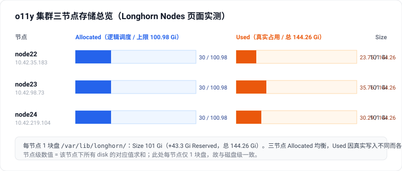
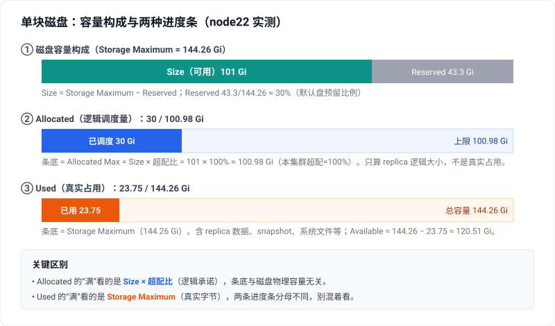
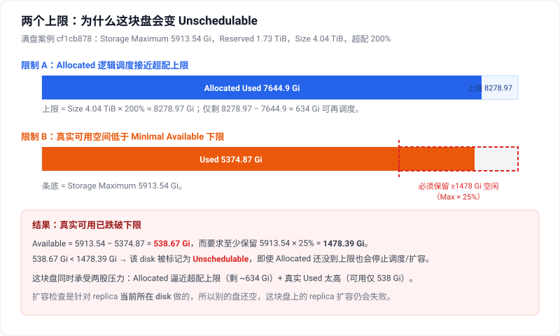

**Allocated 是“已经承诺/调度出去的容量”，Used 是“宿主机磁盘上实际已经被占用的容量”。**
Allocated 主要受 **Storage Over Provisioning Percentage** 影响；Used / Available 主要受真实写入、快照、系统文件和 **Storage Minimal Available Percentage** 影响。

Longhorn 在 UI 上会从多个角度展示存储量，数字之间的分母还不一样，第一次看很容易混。下面我按“先看 UI → 磁盘级别 → 节点级别 → 三个参数 → 完整例子”来讲，并配上一套真实集群（o11y，Longhorn v1.11.2）的实测图示。

先看一眼 Node 页面的整体样子——三个节点，每个都有 Allocated、Used、Size 三列：



*图 1：o11y 集群 Nodes 页面三节点实测总览。注意 Allocated 与 Used 两条进度条的分母并不相同。*

------

## 1. 磁盘上的 Allocated 是怎么算的？

在 Longhorn Node 页面展开某个节点后，每块 disk 上的 **Allocated** 通常显示为：

```text
Allocated Used / Allocated Max
```

它不是实际磁盘占用，而是 Longhorn 为 replica 调度时记录的“已调度容量”。

公式可以理解为：

```text
Disk Allocated Used = 这块 disk 上所有 replica 的逻辑大小之和
Disk Allocated Max  = (Storage Maximum - Storage Reserved) × Storage Over Provisioning Percentage
```

Longhorn 官方文档说明，Node 页面的 `Allocated` 左边数字是已经用于 volume scheduling 的大小，不代表 Longhorn 数据实际占用；右边数字是 `Size × Storage Over Provisioning Percentage`。([Longhorn](https://longhorn.io/docs/latest/nodes-and-volumes/nodes/node-space-usage/))

其中：

```text
Storage Maximum  = 这块磁盘文件系统总容量
Storage Reserved = Longhorn 不允许自己使用、预留给系统/其他用途的容量
Storage Maximum - Storage Reserved = Longhorn 认为这块盘可用于 volume 的 usable size
```

所以 **Allocated 看的是“volume/replica 申请了多少容量”**，不是实际写了多少数据。

例如：一个 500Gi PVC，3 副本，如果 1 个副本落在这块盘上，那么这块盘的 `Allocated Used` 增加约 500Gi。即使业务实际只写了 20Gi，Allocated 仍然按 500Gi 算。

------

## 2. 磁盘上的 Used 是怎么算的？

磁盘上的 **Used** 通常显示为：

```text
Used / Storage Maximum
```

它接近宿主机文件系统层面看到的真实占用。

公式可以理解为：

```text
Disk Used = Storage Maximum - Storage Available
```

它包括：

```text
Longhorn replica 实际数据
Longhorn snapshot 数据
Longhorn metadata
该挂载点上其他文件
文件系统自身开销
```

Longhorn 文档说明，Dashboard 里的 `Used` 是 Longhorn、系统和其他应用实际已经使用的空间；Node 页面的 `Used` 左边表示当前 node 已用空间，整条 bar 表示 node 总空间。([Longhorn](https://longhorn.io/docs/latest/nodes-and-volumes/nodes/node-space-usage/))

所以 **Used 不等于 Longhorn replica 的逻辑大小**。它会受这些因素影响：

```text
业务实际写入量
snapshot 数量
是否执行过 snapshot purge
guest filesystem 是否 discard / fstrim
Longhorn 数据目录里是否有 orphaned data
宿主机上是否还有其他文件
```

把 Allocated 和 Used 放到同一块盘上看，最直观。下面这张图用 node22 的实测值，拆开一块盘的“容量构成”和两条分母不同的进度条：



*图 2：单块磁盘（node22，`/var/lib/longhorn/`）的容量构成与两种进度条。①容量 = Size + Reserved；②Allocated 的分母是 Size×超配比；③Used 的分母是 Storage Maximum。三者分母不同，别混着读。*

------

## 3. 节点上的 Allocated / Used 是怎么算的？

节点级别基本就是把该节点下所有 Longhorn disk 汇总。

```text
Node Allocated Used = Σ 所有 disk 的 Allocated Used
Node Allocated Max  = Σ 所有 disk 的 Allocated Max
Node Used = Σ 所有 disk 的 Used
Node Total = Σ 所有 disk 的 Storage Maximum
```

节点的 `Size` 则是：

```text
Node Size = Σ (Storage Maximum - Storage Reserved)
```

Longhorn 文档里也说，Node 页面的 `Size` 是 Longhorn volume 可使用的最大实际空间，等于节点总磁盘空间减去 reserved space。([Longhorn](https://longhorn.io/docs/latest/nodes-and-volumes/nodes/node-space-usage/))

> 上面图 1 的 o11y 集群里，每个节点只有 1 块盘，所以“节点级”数值与“磁盘级”完全一致：Size 101 Gi、Allocated 30 / 100.98 Gi、Used 各自约 23~36 / 144.26 Gi。多块盘时才需要按上面的公式求和。

------

## 4. Storage Over Provisioning Percentage 的作用

这个参数控制的是 **Allocated Max**，也就是“最多允许调度多少逻辑容量”。

公式：

```text
Allocated Max = (Storage Maximum - Storage Reserved) × OverProvisioning%
```

官方文档给出的定义是：`StorageOverProvisioningPercentage` 定义一块盘相对其 usable capacity 最多可以 schedule 多少存储，公式对应 `ScheduledStorage / (MaximumStorage - ReservedStorage)`。([Longhorn](https://longhorn.io/docs/1.11.0/nodes-and-volumes/nodes/multidisk/))

> **实测提示**：o11y 集群的超配比是 **100%**，所以图 1/图 2 里 `Allocated Max ≈ Size`（100.98 ≈ 101 Gi）。下面的例子为了体现“超配”效果用的是 **200%**，两者只是参数取值不同，公式一致。

例如：

```text
磁盘总容量 Storage Maximum = 10 TiB
Storage Reserved = 2 TiB
Longhorn usable size = 8 TiB
OverProvisioning = 200%
```

那么：

```text
Allocated Max = 8 TiB × 200% = 16 TiB
```

这表示 Longhorn 最多可以往这块盘上调度 16TiB 的 replica 逻辑容量，虽然真实 usable 只有 8TiB。

这就是为什么你会看到：

```text
Allocated 可能大于真实磁盘容量
```

这是正常的，因为 Longhorn 是 thin provisioning / sparse file 思路：不是所有 PVC 一创建就真的写满。

------

## 5. Storage Minimal Available Percentage 的作用

这个参数控制的是 **真实可用空间下限**。它不是控制 Allocated Max，而是防止真实磁盘太满。

Longhorn/SUSE 文档说明，`Storage Minimal Available Percentage` 控制在调度新 replica 前，磁盘上必须保留的最小空闲比例；如果新增 replica 会让 available space 低于限制，Longhorn 会暂时把该 disk 标记为不可调度。([SUSE 文档](https://documentation.suse.com/cloudnative/storage/1.11/en/longhorn-system/settings.html))

可以理解为：

```text
必须满足：
Storage Available >= Storage Maximum × MinimalAvailablePercentage
```

在一些文档/版本示例里也会按 usable capacity 解释，但你实际排障时以 Longhorn 事件里的字段为准。报错事件里通常已经直接打印了：

```text
StorageAvailable
StorageMaximum
StorageReserved
StorageScheduled
OverProvisioningPercentage
MinimalAvailablePercentage
```

所以判断时可以直接套事件里的值。

举例：

```text
Storage Maximum = 10 TiB
Minimal Available Percentage = 25%
```

那么 Longhorn 希望至少保留：

```text
10 TiB × 25% = 2.5 TiB
```

如果真实可用空间低于 2.5TiB，即使 Allocated 还没达到上限，Longhorn 也可能不再接受新 replica 或扩容。

这就是 PVC 扩容失败的一个常见核心原因：**不是 Allocated Max 一定满了，而是 Storage Available 没有达到 Minimal Available 的要求。**

------

## 6. Storage Reserved Percentage For Default Disk 的作用

这个参数只影响 **默认磁盘的初始 reserved space**。

Longhorn/SUSE 文档说明，`Storage Reserved Percentage For Default Disk` 表示每个新 Longhorn 节点上的 default disk 有多少比例不会分配给 Longhorn；默认值是 30，并且它只影响安装时或新增节点时创建的 default disk。([SUSE 文档](https://documentation.suse.com/cloudnative/storage/1.11/en/longhorn-system/settings.html))

公式：

```text
Storage Reserved = Storage Maximum × Storage Reserved Percentage For Default Disk
```

> 图 1/图 2 的 o11y 集群正好用的是默认 30%：Reserved 43.3 Gi ÷ Storage Maximum 144.26 Gi ≈ 30%，于是 Size = 144.26 − 43.3 ≈ 101 Gi。

例如：

```text
新节点 default disk 总容量 = 10 TiB
Storage Reserved Percentage For Default Disk = 30%
```

那么新 default disk 会自动预留：

```text
10 TiB × 30% = 3 TiB
```

Longhorn usable size 变成：

```text
10 TiB - 3 TiB = 7 TiB
```

重要区别：`Storage Reserved Percentage For Default Disk` 只是在创建 default disk 时帮你生成一个 `Storage Reserved` 值。它不会持续动态调整已有磁盘的 reserved space。已有磁盘要改 reserved，需要在 Node → Edit Disks 或修改 `nodes.longhorn.io` 里的 disk `storageReserved`。

------

## 7. 用一个完整例子说明

假设一个节点上有 1 块 Longhorn disk：

```text
Storage Maximum = 10 TiB
Storage Reserved Percentage For Default Disk = 30%
Storage Over Provisioning Percentage = 200%
Storage Minimal Available Percentage = 25%
```

### 第一步：计算 Reserved 和 Size

```text
Storage Reserved = 10 TiB × 30% = 3 TiB
Longhorn Size / Usable = 10 TiB - 3 TiB = 7 TiB
```

UI 上可能看到：

```text
Size: 7 TiB
+3 TiB Reserved
```

### 第二步：计算 Allocated Max

```text
Allocated Max = 7 TiB × 200% = 14 TiB
```

也就是说，Longhorn 最多允许在这块盘上调度 14TiB 的 replica 逻辑容量。

### 第三步：调度几个 PVC

假设有这些 volume replica 被调度到这块盘：

```text
PVC A: 2 TiB
PVC B: 1 TiB
PVC C: 4 TiB
```

那么：

```text
Allocated Used = 2 + 1 + 4 = 7 TiB
Allocated Max = 14 TiB
```

UI 上看到：

```text
Allocated: 7 TiB / 14 TiB
```

这不代表真实已经用了 7TiB，只代表 Longhorn 已经承诺了 7TiB 逻辑容量。

### 第四步：真实写入量

假设实际写入和快照占用如下：

```text
PVC A 实际占用 + snapshot = 1.2 TiB
PVC B 实际占用 + snapshot = 0.3 TiB
PVC C 实际占用 + snapshot = 2.5 TiB
系统/其他文件 = 0.5 TiB
```

那么：

```text
Used = 1.2 + 0.3 + 2.5 + 0.5 = 4.5 TiB
Available = 10 TiB - 4.5 TiB = 5.5 TiB
```

UI 上看到：

```text
Used: 4.5 TiB / 10 TiB
```

### 第五步：Minimal Available 检查

```text
Minimal required free = 10 TiB × 25% = 2.5 TiB
```

当前：

```text
Available = 5.5 TiB
```

满足：

```text
5.5 TiB > 2.5 TiB
```

所以这块盘还能继续调度。

### 第六步：什么时候会停止调度？

有两个常见停止条件。

**条件 A：Allocated 达到 OverProvisioning 上限**

```text
Allocated Used + 新 replica size > Allocated Max
```

例如当前：

```text
Allocated Used = 13.8 TiB
Allocated Max = 14 TiB
```

再调度一个 500Gi replica：

```text
13.8 TiB + 0.5 TiB = 14.3 TiB > 14 TiB
```

失败。

**条件 B：真实 available 低于 Minimal Available 下限**

例如：

```text
Used = 8 TiB
Available = 2 TiB
Minimal required free = 2.5 TiB
```

此时：

```text
2 TiB < 2.5 TiB
```

即使 Allocated 还没满，也会停止调度或扩容失败。

------

## 8. 套到一块真实满盘上

再看一块真实的满盘 `cf1cb878...`（来自另一处更大的磁盘，不是上面 o11y 的 144Gi 盘），它大概是：

```text
Size:      4.04 TiB
Reserved: +1.73 TiB
Used:      5374.87 / 5913.54 Gi
Allocated: 7644.9 / 8278.97 Gi
OverProvisioning: 200%
```

反推：

```text
Storage Maximum ≈ 5913.54 Gi ≈ 5.77 TiB
Storage Reserved ≈ 1.73 TiB
Usable Size ≈ 4.04 TiB
Allocated Max ≈ 4.04 TiB × 200% ≈ 8.08 TiB ≈ 8278.97 Gi
```

这就解释了为什么 Allocated Max 是 8278.97Gi：它不是物理盘大小，而是 `Longhorn usable size × 200%`。

这块盘同时面临 Allocated 逻辑调度接近上限、真实 Used 又太高两股压力。下面这张图把两个上限画在一起：



*图 3：满盘案例的两个上限。限制 A 是 Allocated 逼近超配上限（剩 ~634 Gi）；限制 B 是真实可用（538.67 Gi）已低于 Max×25% ≈ 1478 Gi 的下限，于是磁盘变 Unschedulable。*

拆开看，当前 Allocated：

```text
Allocated Used = 7644.9 Gi
Allocated Max = 8278.97 Gi
剩余可调度 ≈ 8278.97 - 7644.9 ≈ 634.07 Gi
```

再看真实空间：

```text
Used = 5374.87 Gi
Storage Maximum = 5913.54 Gi
Available ≈ 5913.54 - 5374.87 = 538.67 Gi
```

如果 `Storage Minimal Available Percentage = 25%`，那么至少要保留的真实空闲空间大约是：

```text
5913.54 Gi × 25% ≈ 1478.39 Gi
```

但当前只有 538.67 Gi，所以这块盘会变成 Unschedulable。也就是说，它同时面临两个压力：

```text
Allocated 逻辑调度接近上限
真实 Used 已经太高，Available 低于 Minimal Available 要求
```

这也是为什么其他盘还空，但这个盘上的某些 replica 扩容会失败：扩容检查是针对**当前 replica 所在 disk** 做的。

------

## 9. 最重要的关系总结

| 项目                                           | 表示什么                           | 主要受什么影响                                               |
| ---------------------------------------------- | ---------------------------------- | ------------------------------------------------------------ |
| `Storage Maximum`                              | 磁盘文件系统总容量                 | 宿主机磁盘大小                                               |
| `Storage Reserved`                             | Longhorn 不使用的预留空间          | 手动设置或 `Storage Reserved Percentage For Default Disk` 初始生成 |
| `Size`                                         | Longhorn 可用真实容量              | `Storage Maximum - Storage Reserved`                         |
| `Allocated Used`                               | 已经调度出去的 replica 逻辑容量    | PVC/Volume size、replica 数、调度位置                        |
| `Allocated Max`                                | 最多允许调度多少逻辑容量           | `Size × Storage Over Provisioning Percentage`                |
| `Used`                                         | 磁盘真实已用空间                   | 真实写入、snapshot、系统文件、orphaned data                  |
| `Available`                                    | 磁盘真实剩余空间                   | `Storage Maximum - Used`                                     |
| `Storage Minimal Available Percentage`         | 调度时必须保留的真实空闲空间比例   | 防止磁盘真实写满                                             |
| `Storage Over Provisioning Percentage`         | 允许逻辑调度超过真实 usable 的比例 | 控制 Allocated Max                                           |
| `Storage Reserved Percentage For Default Disk` | 新 default disk 初始预留比例       | 只影响 default disk 创建时的 `Storage Reserved`              |

一句话：

**Allocated 解决“Longhorn 承诺了多少容量”的问题；Used 解决“宿主机磁盘真实用了多少”的问题；Over Provisioning 限制 Allocated；Minimal Available 限制真实剩余空间；Reserved Percentage 只是在 default disk 创建时决定预留多少空间。**

## 参考

- Longhorn 官方文档 · Node Space Usage：<https://longhorn.io/docs/latest/nodes-and-volumes/nodes/node-space-usage/>
- Longhorn 官方文档 · Multiple Disk Support：<https://longhorn.io/docs/1.11.0/nodes-and-volumes/nodes/multidisk/>
- SUSE 文档 · Longhorn Settings：<https://documentation.suse.com/cloudnative/storage/1.11/en/longhorn-system/settings.html>
